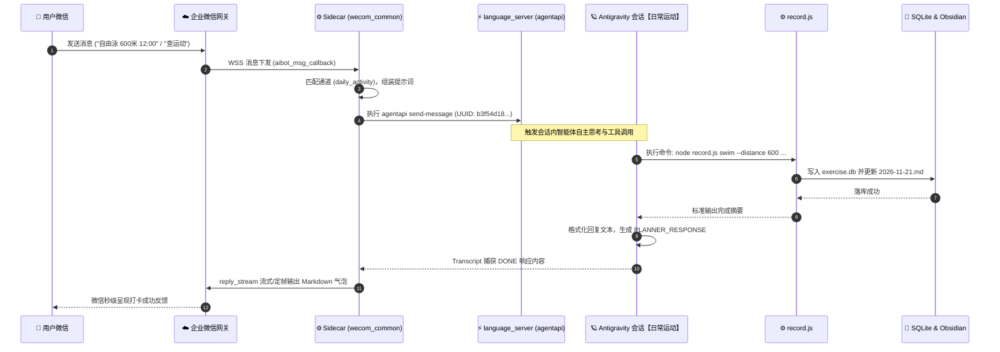
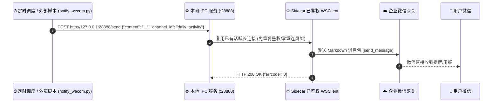

# 企业微信与 Antigravity 协同系统架构 (Architecture)

本文档阐述 `wechat_common` 与 Google Antigravity 原生环境之间的多通道系统架构、通信协议、时序交互与生命周期管理机制。

---

## 1. 整体架构与拓扑关系

系统采用**Sidecar 原生常驻守护 + 多通道并发分流 + 会话原生 AI 载体**的三层架构：

```mermaid
flowchart TD
    subgraph 移动端与腾讯云
        User["📱 用户手机 (微信 / 企业微信 App)"]
        WeComGW["☁️ 腾讯企业微信网关 (wss://openws.work.weixin.qq.com)"]
        User <-->|双向收发| WeComGW
    end

    subgraph Antigravity 宿主与 Sidecar 守护层
        AGY["🪐 Google Antigravity 宿主进程"]
        SidecarDaemon["⚙️ Antigravity Sidecar: wecom-channel-daemon<br>(~/.gemini/config/sidecars/wecom-channel-daemon)"]
        IPCServer["🌐 本地 IPC 分发端口 (:28888)<br>(支持按 channel_id / bot_id 路由推送)"]
        
        AGY -->|启动时自动加载并守护 (restart_policy: always)| SidecarDaemon
        SidecarDaemon --> IPCServer
    end

    subgraph wechat_common 多通道调度引擎
        ConfigMgr["📦 统一配置中心 (wecom_config.json)"]
        ChRunner1["🔀 ChannelRunner: 日常运动<br>(WSClient A + SessionBridge A)"]
        ChRunner2["🔀 ChannelRunner: 健身私教<br>(WSClient B + SessionBridge B)"]
        ChRunnerN["🔀 ChannelRunner: 专属助手 N<br>(WSClient N + SessionBridge N)"]

        SidecarDaemon --> ConfigMgr
        ConfigMgr --> ChRunner1
        ConfigMgr --> ChRunner2
        ConfigMgr --> ChRunnerN
    end

    subgraph Antigravity 原生会话层
        LangServer["⚡ language_server.exe agentapi send-message"]
        Session1["💬【日常运动_Session】(b3f54d18...)<br>技能：散步/游泳/徒步/开髋/冥想"]
        Session2["💬【健身私教】(9ba2c4db...)<br>技能：力量训练/CGM血糖/专项指导"]
        SessionN["💬【自定义工作区会话】(UUID N)"]

        ChRunner1 <-->|驱动交互| LangServer
        ChRunner2 <-->|驱动交互| LangServer
        ChRunnerN <-->|驱动交互| LangServer

        LangServer --> Session1
        LangServer --> Session2
        LangServer --> SessionN
    end

    subgraph 本地存储与数据库
        RecordJS["⚙️ 运动打卡执行器 (record.js)"]
        SQLiteDB[("💾 SQLite exercise.db")]
        VaultMD["📝 Obsidian 笔记与流水日志 (*.md)"]

        Session1 -->|自主调用命令| RecordJS
        RecordJS --> SQLiteDB
        RecordJS --> VaultMD
    end

    WeComGW <-->|WSS 独立长连接 A| ChRunner1
    WeComGW <-->|WSS 独立长连接 B| ChRunner2
    WeComGW <-->|WSS 独立长连接 N| ChRunnerN
```

---

## 2. 核心交互时序图

### 2.1 双向交互时序（微信打卡 / 查询 / 对话）



### 2.2 主动推送时序（定时提醒 / 运动周报）



---

## 3. 关键设计规范

### 3.1 Sidecar 宿主生命周期机制
- **配置位置**：`~/.gemini/config/sidecars/wecom-channel-daemon/sidecar.json`。
- **自动启动**：Antigravity 启动时自动发现并运行该服务，彻底省去手动启动命令或 Windows 开机启动项维护。
- **高可用常驻**：设置 `"restart_policy": "always"`，遇异常崩溃由 Antigravity 宿主自动拉起重启。
- **日志隔离**：标准控制台输出统一重定向至 `~/.gemini/antigravity/sidecar_data/wecom-channel-daemon/logs/sidecar.log`。

### 3.2 会话作为原生 AI 载体（Session as Carrier）
- **绝不篡改历史**：不从外部磁盘篡改 `transcript.jsonl`，避免 React 状态不同步。
- **原生驱动**：通过 `language_server.exe agentapi send-message --title="..." <session_id> <prompt>` 注入消息，触发该会话中具备的特定技能（Skills）、规则（Rules）和模型配置。
- **多端一致**：无论在电脑端 Antigravity 界面直接打字，还是通过手机微信发送，会话的历史记录和界面视图完全一致。

### 3.3 严格上下文隔离与多通道扩展
- **通道定义**：在 `wecom_config.json` 的 `channels` 中声明每个 Bot 的 `id`、`name`、`bot_id`、`session_id`。
- **上下文物理隔离**：
  - `【日常运动】` 会话：仅处理日常轻运动，禁止或自动拦截大重量力量训练。
  - `【健身私教】` 会话：仅处理大重量器械、CGM血糖联动与专项体能计划。
  - 两个 Bot 互相独立运行，永不串话。

### 3.4 本地规则兜底机制（Resilience Fallback）
- 若 Antigravity 会话处理由于网络或高并发在设定超时内未返回，守护层内的 `DailyActivitySession.parse_and_record` 会自动接管，直接通过本地 `record.js` 解析落库，确保**用户运动打卡数据 100% 不丢失**。
